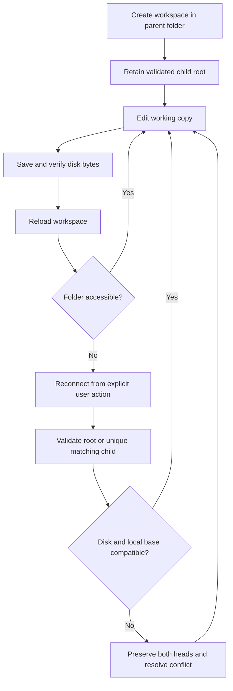

## prod_021_reliable_folder_reconnection_for_named_workspace_persistence - Reliable folder reconnection for named workspace persistence
> Date: 2026-10-19
> Status: Settled
> Related request: `req_170_make_folder_reconnection_reliable_for_newly_created_named_workspaces`
> Related backlog: `item_691_repair_named_workspace_folder_connection_lifecycle_and_safe_reconnection`
> Related task: `task_167_deliver_reliable_new_workspace_folder_reconnection`
> Related architecture: (none yet)
> Reminder: Update status, linked refs, scope, decisions, success signals, and open questions when you edit this doc.
> Indicators reviewed: 2026-10-20 09:48:14

# Overview
A focused extension of prod_018: a newly created or temporarily disconnected folder-backed workspace can regain access to its own lineage root and save current edits without losing recovery data or claiming unverified disk persistence. Settings explains the next action for each access outcome.

# Goals
- Make create, reconnect, Save and reload a reliable end-to-end folder workflow.
- Accept the lineage root or its parent while validating stable workspace identity.
- Preserve local and disk work through failed access and divergent copies; provide truthful localized status.

# Non-goals
- New storage modes, cloud sync, account integration or changes to portable schemas.
- Moving browser-only workspaces to disk, recreating deleted lineage folders or rebuilding corrupt manifests through reconnect.
- Automatic merging, automatic history pruning, recursive disk discovery or broader Settings redesign.

# Scope and guardrails
- In: creation/activation, stored-handle recovery, identity-based root/parent selection, verified Save, session isolation and localized Settings guidance.
- Preserve editor edits, local recovery, immutable history and the prior disk revision base. Reconnect never overwrites a different or diverged workspace.
- Browser-only storage and historical read-only protections retain their current contracts.

# Key product decisions
- Creation selects a parent; reconnection accepts a lineage root or a parent with one immediate matching child. Stable workspaceId, not display name, determines the target.
- Permission renewal and folder selection are explicit user actions. Cancellation is neutral, and unsupported access offers the existing browser/ZIP alternative.
- A connection success does not claim a disk save; verified writes alone advance durable-save state.
- A changed same-ID disk copy uses existing preservation and conflict handling before saving local edits.

# Success signals
- A newly created workspace can be edited and saved immediately and after reload without a missing-folder loop.
- Reconnecting a root or parent restores saving while retaining current edits and all history.
- Failed access and cancelled selection leave a clear retry path without false success or data loss.
- Automated failure/isolation checks and a real OS picker scenario verify the complete workflow.

# References
- Product back-reference: `item_691_repair_named_workspace_folder_connection_lifecycle_and_safe_reconnection`
- Task back-reference: `task_167_deliver_reliable_new_workspace_folder_reconnection`
