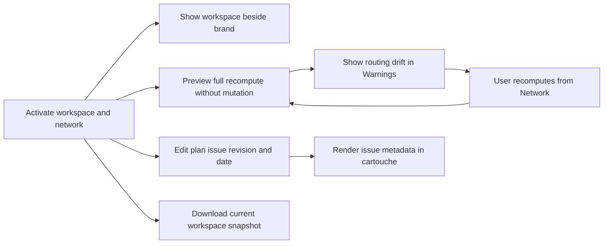

## prod_022_plan_issue_traceability_and_everyday_workspace_confidence - Plan issue traceability and everyday workspace confidence
> Date: 2026-10-22
> Status: Proposed
> Related request: `req_171_add_plan_issue_metadata_proactive_routing_drift_warnings_and_visible_portable_workspace_controls`
> Related backlog: `item_693_persist_plan_issue_revision_and_date_and_render_them_in_export_cartouches`, `item_694_detect_full_network_recompute_drift_with_pure_cached_warnings`, `item_695_download_the_current_workspace_snapshot_from_a_copy_action`, `item_696_keep_active_workspace_identity_visible_beside_the_application_brand`
> Related task: `task_168_deliver_plan_issue_metadata_routing_drift_checks_and_workspace_copy_visibility`
> Related architecture: (none yet)
> Reminder: Update status, linked refs, scope, decisions, success signals, and open questions when you edit this doc.
> Indicators reviewed: 2026-10-22 11:57:05

# Overview
Make exported plans identifiable by issue revision/date, warn about recompute drift before manual correction, and keep the active workspace visible and easy to copy as a portable current-state snapshot.

# Goals
- Identify the issued plan independently from technical save and application versions.
- Detect routing drift without modifying the design or slowing normal work.
- Download the current workspace snapshot directly from Current workspace.
- Show workspace identity beside the brand throughout the application.

# Non-goals
- Automated issue approval, distribution, supplier messaging or automatic revision numbering.
- Automatic rerouting, new route optimization rules or a new validation dashboard.
- Independent lineage forks, clipboard integration, copying filesystem directories or replacing ZIP/history export.
- Runtime implementation or release publication in this documentation change.

# Scope and guardrails
- In: scaffolded request, product, backlog, orchestration task, validation, and handoff context.
- Out: unrelated workflow docs and implementation of generated tasks.

# Key product decisions
- Use structured input as the source of truth for generated docs.
- Keep generated write paths local and repo-bounded.

# Success signals
- Generated docs pass lint and audit without broad manual rewrites.
- Context-pack output can be handed to an implementation agent directly.

# References
- Product back-reference: `req_171_add_plan_issue_metadata_proactive_routing_drift_warnings_and_visible_portable_workspace_controls`
- Task back-reference: `task_168_deliver_plan_issue_metadata_routing_drift_checks_and_workspace_copy_visibility`
