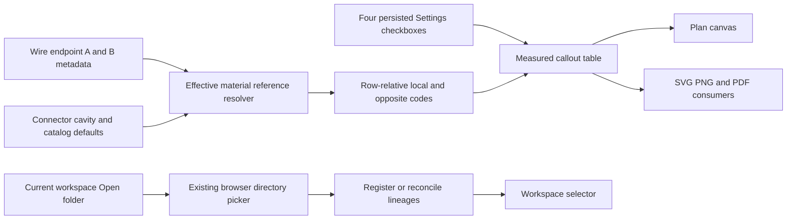

## prod_023_configurable_endpoint_material_references_on_plans_and_direct_workspace_folder_access - Configurable endpoint material references on plans and direct workspace folder access
> Date: 2026-10-22
> Status: Settled
> Related request: `req_172_show_local_and_opposite_endpoint_connection_and_seal_references_in_plan_callouts_and_expose_open_folder_beside_workspace_actions`
> Related backlog: `item_697_carry_effective_local_and_opposite_endpoint_material_references_into_callout_rows`
> Related task: `task_169_deliver_configurable_callout_endpoint_references_and_current_workspace_open_folder_access`
> Related architecture: (none yet)
> Reminder: Update status, linked refs, scope, decisions, success signals, and open questions when you edit this doc.
> Indicators reviewed: 2026-10-22 20:30:10

# Overview
Make plan callouts useful for wiring assembly by showing connection/contact and seal reference codes for the represented endpoint and optionally its opposite, while placing the existing workspace folder-opening action beside everyday workspace controls.

# Goals
- Choose connection and seal visibility independently for each endpoint side.
- Keep on-screen and exported plan references readable and consistent with effective material configuration.
- Open existing workspace folders from the current-workspace action row.

# Non-goals
- Editing termination metadata from callouts, changing routing or BOM quantities, or introducing new wire fields.
- Per-wire/per-workspace visibility overrides, tracing through splices or new export formats.
- OS file-manager reveal, new storage modes, automatic workspace switching, changing Copy/reconnect semantics or release publication.

# Scope and guardrails
- Four independent global display booleans default to false; no new Wire business fields or workspace dirty-state changes.
- Effective endpoint references follow existing manual-over-connector/catalog precedence. Opposite means the other endpoint of the same wire.
- Keep existing grouping and drawing modes; account for wrapped reference text in layout, caches and export bounds.
- Move the existing Open folder picker into Current workspace and retain explicit workspace selection and established lineage reconciliation.

# Key product decisions
- Show reference codes rather than material names; use an em dash for missing enabled values.
- Apply the same optional columns to connector and splice wire-detail callouts and their existing export consumers.
- Provide separate connection and seal checkboxes for this side and opposite side, allowing any combination with immediate preview.
- Open folder selects an existing workspace root or parent through the browser picker; it does not open a native file manager or automatically switch the active design.
- Keep prod_018 authoritative for portable lineage identity, history and storage guarantees.

# Success signals
- Asymmetric A/B fixtures render the correct codes from either endpoint with independent visibility and no changes to saved wire data.
- Screen and exported plans remain readable with long references, all fields enabled and EN/FR headers.
- Users find Open folder beside Save, Rename and Copy, including before selecting an active workspace.
- Per-AC model, UI and export evidence and relevant repository checks pass before implementation closeout.

# Overview diagram

# References
- Product back-reference: `item_697_carry_effective_local_and_opposite_endpoint_material_references_into_callout_rows`
- Task back-reference: `task_169_deliver_configurable_callout_endpoint_references_and_current_workspace_open_folder_access`
