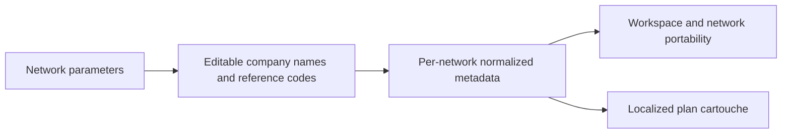

## prod_024_editable_manufacturer_and_supplier_identification_on_network_plans - Editable manufacturer and supplier identification on network plans
> Date: 2026-10-23
> Status: Proposed
> Related request: `req_173_add_editable_manufacturer_and_supplier_references_to_network_settings_and_plan_cartouches`
> Related backlog: `item_700_persist_per_network_manufacturer_and_supplier_plan_reference_metadata`, `item_701_edit_manufacturer_and_supplier_company_names_and_references_in_network_parameters`, `item_702_render_manufacturer_and_supplier_plan_references_in_export_cartouches`
> Related task: `task_170_deliver_editable_network_manufacturer_and_supplier_references_in_plan_cartouches`
> Related architecture: (none yet)
> Reminder: Update status, linked refs, scope, decisions, success signals, and open questions when you edit this doc.

# Overview
Identify a network plan using two independent business reference codes with editable company names, maintained in network parameters and rendered consistently in plan cartouches.

# Goals
- Support one manufacturer and one supplier reference per network.
- Allow users to change both associated company names without changing role semantics.
- Keep saved, portable and exported plan identification consistent across networks and versions.

# Non-goals
- Arbitrary additional reference roles, multiple suppliers or company directories.
- Catalog/contact/BOM reference changes, automatic lookup or synchronization with external companies.
- Release approvals, automatic reference numbering, global company defaults or a new export format.
- Runtime implementation or release publication in this documentation change.

# Scope and guardrails
- In: scaffolded request, product, backlog, orchestration task, validation, and handoff context.
- Out: unrelated workflow docs and implementation of generated tasks.

# Key product decisions
- Use structured input as the source of truth for generated docs.
- Keep generated write paths local and repo-bounded.

# Success signals
- Generated docs pass lint and audit without broad manual rewrites.
- Context-pack output can be handed to an implementation agent directly.

# References
- Product back-reference: `req_173_add_editable_manufacturer_and_supplier_references_to_network_settings_and_plan_cartouches`
- Task back-reference: `task_170_deliver_editable_network_manufacturer_and_supplier_references_in_plan_cartouches`
